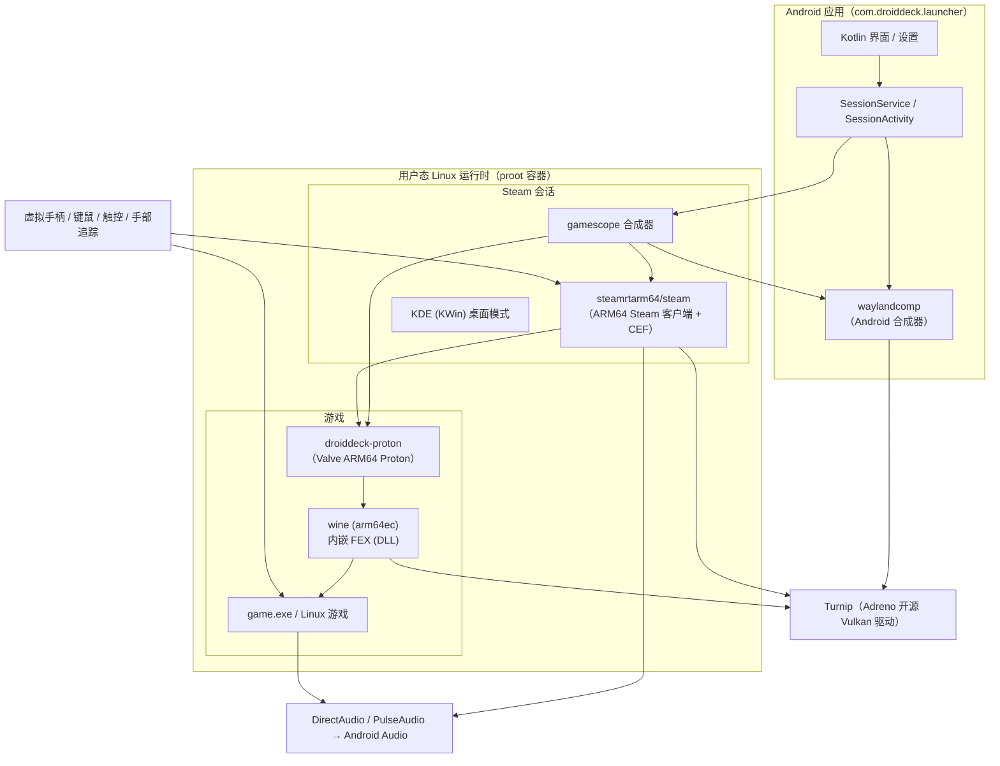
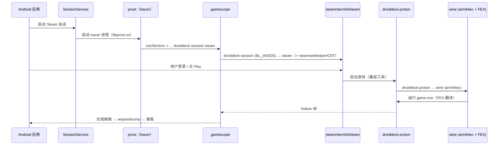

# 工作原理 / How It Works

本文档深入说明 **DYSteam Lite** 如何在 Android 设备上运行 Steam 客户端与 Windows 游戏。DYSteam Lite 是 [DroidDeck](https://github.com/Droid-Deck/DroidDeck) 的复刻与增强版，以下原理与原项目一致，并依据本仓库 `docs/development/` 下的技术文档整理。

---

## 总览 / Overview

Android 应用默认无法运行桌面 Linux 程序，更无法运行 Steam 与 Windows 游戏，原因有三：

1. **没有 glibc 用户态根文件系统**（Android 使用 bionic libc）。
2. **架构不同**（设备是 ARM64，而大部分 Steam 游戏是 x86-64）。
3. **缺少桌面图形栈所需的 X11 / Wayland 与相关设备节点**，且应用 seccomp 策略屏蔽了大量 Linux 系统调用。

DYSteam Lite 的答案是：**在无需 root 的前提下，用 proot 搭一个用户态 Linux 运行时，在其中运行 ARM64 Steam 客户端，再用内嵌 FEX 的 ARM64 Proton 运行 Windows 游戏，最后通过 Turnip Vulkan 驱动与 gamescope 合成器输出画面。**



---

## 组件说明 / Components

### 1. proot —— 用户态根文件系统

**proot** 通过 ptrace（及 seccomp 过滤）在用户态实现 chroot / 路径翻译与系统调用仿真：

- 在**无需 root** 的前提下，把一个 Arch Linux 根文件系统挂载为会话的「/」；
- 翻译客体内路径到宿主机真实路径（支持约 25 个 bind 挂载：`/dev`、`/proc`、`/sys`、GPU 节点、`/dev/shm`、存储与游戏库等）；
- 补齐 Android 应用 seccomp 策略屏蔽的系统调用（`rseq`、`set_robust_list`、`faccessat2`、`fchmodat2`、`openat2`、`set*id` 系列、`futex_waitv` 等），它们以 `SIGSYS` 到达 proot，由 proot 仿真。

关键性能结论（来自 [proot-performance](../development/proot-performance.md)）：

- 游戏运行期间，GPU 提交（`ioctl`）、`futex`、`read`/`write`、`mmap`、`ppoll`/`epoll`、`sendmsg`/`recvmsg`、`clock_gettime`（经 vDSO）等已在原生速度运行；
- 真正耗时的仍是每个**路径类系统调用**、`execve`、`brk`、线程 / 进程创建与被 Android 屏蔽的系统调用（15–60 µs/次，对比原生 ~0.5 µs），它们都经过**唯一的 tracer 线程**（上限约 75–95k traps/s）；
- 本项目通过补丁 0001–0013 及进程内快速路径（fast path，补丁 0014）大幅削减这些开销。

### 2. box64 / FEX —— x86-64 翻译

在 ARM64 设备上运行 x86-64 程序需要指令翻译：

- **FEX**：作为 DLL 载入 Wine 进程内，把 x86-64 指令翻译为 ARM64；其 **host thunks** 把 x86 程序的 libvulkan / libGL / libX11 等调用直通到运行时的 ARM64 库（Turnip、Mesa）。
- **box64**：作为可选的替代 / 自定义组件提供（在游戏环境编辑器中可见，需配合相应的自定义组件）。

x86-64 Steam 客户端（可选，实验性）也通过独立的 FEX 运行时运行，用于 VAC 反作弊场景（详见 [x86-64-steam-client](../development/x86-64-steam-client.md)）。

### 3. Wine / Proton —— Windows 兼容层

- 默认客户端是 Valve 的 **ARM64 Linux 版 Steam**（`steamrtarm64/steam`），由 `droiddeck-steam-install` 安装、`droiddeck-session` 以 `STEAM_RUNTIME=1` 启动。
- Windows 游戏通过 Valve 的 **ARM64 Proton** 运行，其 `wine` 是 **arm64ec** 构建，FEX 作为 DLL 载入其中翻译 x86-64 游戏代码。
- Proton 相关的 `esync` / `fsync` / `ntsync` 同步原语用于加速多线程 Windows 游戏；其中 `futex_waitv` 被 Android 屏蔽，由 `droiddeck-fsync` 在会话 preload 中仿真。

### 4. DXVK / VKD3D-Proton / Turnip —— 图形转译与执行

| 层 | 作用 |
| --- | --- |
| **DXVK** | DirectX 9 / 10 / 11 → Vulkan |
| **VKD3D-Proton** | DirectX 12 → Vulkan（默认 `VKD3D_FEATURE_LEVEL=12_2`、`VKD3D_SHADER_MODEL=6_9`） |
| **Turnip** | Adreno（高通骁龙）的开源 Vulkan 驱动，最终执行 Vulkan 命令 |

图形环境变量（`MESA_SHADER_CACHE_DISABLE`、`VKD3D_CONFIG`、`DXVK_CONFIG` 等）可通过「游戏环境编辑器」逐游戏覆盖，详见 [game-environment](../development/game-environment.md)。

### 5. gamescope —— 合成器

**gamescope** 是 SteamOS 同款微合成器，负责：

- 窗口合成与缩放（Steam 客户端与游戏分别运行在两个 Xwayland 服务器上，`--xwayland-count 2`）；
- 帧率限制、性能叠加层（mangoapp）与帧时间图；
- 把最终画面交给 Android 侧的 `waylandcomp` 合成器，再经面板大小的 swapchain 输出。

会话默认分辨率为 720p（高度预设 720p / 900p / 1080p，形状跟随面板且不窄于 16:9），详见 [steam-display-scaling](../development/steam-display-scaling.md)。

### 6. PipeWire / DirectAudio —— 音频

- Steam 客户端音频经 @The412Banner 的 **DirectAudio** PulseAudio 接收端（LGPL-2.1-or-later）输出，其请求大小被保持在环形缓冲区内，避免客户端被要求提前排队 100 ms。
- Steam Remote Play 串流的**视频**经 **PipeWire** 采集（与 SteamOS 相同），由手机硬件编码器编码；音频与输入一并流式传输。

### 7. 输入栈

- 实体手柄被识别为 Xbox 360 手柄；虚拟 Steam Controller 由 mmap 环形缓冲区输入（ribbit384）驱动。
- 支持键盘鼠标、可自定义触控手势（单指 / 双指 / 三指拖拽、捏合缩放等）、裸手手势（MediaPipe）与 Joy-Con 手柄。

---

## 启动流程 / Startup Flow



1. 应用启动会话，`SessionService` 通过 `HostProcess` 启动 **proot**（单个 tracer 进程，2 秒后 renice 到 -6）。
2. proot 内运行 `droiddeck-session steam`，它再启动 **gamescope**，gamescope 内运行 Steam 客户端（`droiddeck-session BL_INSIDE`）。
3. 用户登录 Steam；点击 Play 后，Steam 通过兼容工具 `droiddeck-proton` 启动 Valve ARM64 Proton。
4. Proton 启动 `wine`（arm64ec，FEX 作为 DLL 内嵌），最终运行 `game.exe`。
5. 游戏的 Vulkan 帧经 gamescope 合成，交给 Android 侧 `waylandcomp` 输出到面板。

> 每棵树中的进程（从会话脚本到游戏）都是同一个 proot 的 tracee。Flatpak 沙箱（`BwrapSpawner`）在**独立的** proot 实例中运行。

---

## 各技术栈 / Stacks

### 图形栈

```
Windows 游戏 → DirectX → DXVK/VKD3D-Proton → Vulkan → Turnip → KGSL (Adreno)
Steam 客户端（CEF）→ GL/Vulkan → Zink/Turnip → gamescope → waylandcomp → 面板
```

### 音频栈

```
Steam 客户端音频 → DirectAudio（PulseAudio 接收端）→ Android Audio
游戏音频 → Wine/Proton → PulseAudio → DirectAudio → Android Audio
Remote Play 视频 → PipeWire 采集 → 硬件编码器
```

### 输入栈

```
实体手柄 → mmap 环形缓冲区 → 虚拟 Xbox/Steam 手柄 → Steam/游戏
触控/键鼠 → 输入注入 → gamescope/Steam
手部追踪 → MediaPipe → 裸手手势 → SteamVR/菜单
```

### 存储栈

```
内部存储 / SD 卡 → proot bind → /root/Games（Steam 库 / 商店库）
  ├─ Steam 库：/mnt/droiddeck-sd（SD 卡）
  └─ 商店库：<Games storage>/Games/<Store>/<title>/ + .droiddeck-store.json 副件
```

---

## 参考文档

- [proot 性能与快速路径](../development/proot-performance.md)
- [ARM64 Steam 客户端](../development/arm64-steam-client.md)
- [x86-64 Steam 客户端](../development/x86-64-steam-client.md)
- [Steam 游戏环境](../development/game-environment.md)
- [Steam 会话显示缩放](../development/steam-display-scaling.md)
- [商店：GOG / Epic / Amazon](../development/stores.md)
- [Flatpak 与 Store](../development/flatpak.md)
- [智能眼镜支持](../smart-glasses-support.md)
